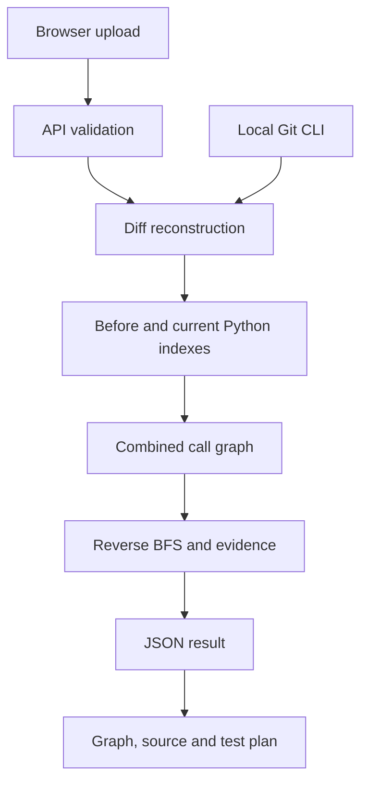

# Architecture

The browser and backend share an origin. The Node server serves static files and routes API calls to bounded input validation and the analysis engine. No frontend build, database or external API is required.

## Pipeline

1. Validate relative `.py` paths, text and size limits.
2. Parse diff hunks and match current-side context exactly.
3. Reverse the patch to reconstruct previous files, including deleted source.
4. Parse both snapshots with Lezer's Python grammar.
5. Index functions/imports and resolve supported calls.
6. Union graph edges to retain deleted dependencies.
7. Map changed lines to function ranges; broaden module-level changes to importers.
8. Walk reverse edges from changed functions and retain a shortest evidence path.
9. Select discovered current pytest functions in the reachable set and return diagnostics.

## Boundaries

The engine has no network, filesystem or process access. The CLI reads tracked files and calls Git with `execFileSync`, without a shell. The server does not use a Python interpreter or execute uploads.

The built-in example uses the same API and engine. Browser state resets on reload. Exported reports are the persistence mechanism.

The Node server uses an asset allowlist, body-size limits, same-origin POST checks and security headers. AST-depth and input limits reduce accidental resource exhaustion. A larger public service would also need infrastructure rate limiting, monitoring and bounded jobs.

Saved projects would require a database, authentication, per-user authorization, retention controls and storage limits. Additional language support requires a real parser and name-resolution implementation, not just a UI dropdown.
